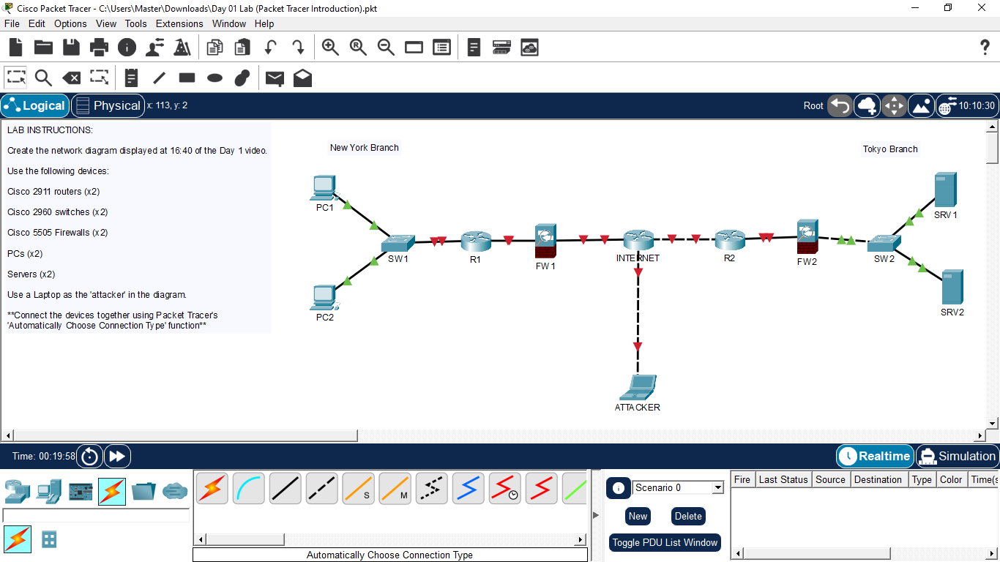

# Day 01: Packet Tracer Introduction & Network Topology

## 🎯 Objective
Built an enterprise multi-branch network topology in Cisco Packet Tracer connecting New York and Tokyo branches across the Internet, including firewalls, routers, switches, servers, end hosts and an external attacker laptop.

## 🖥️ Topology Screenshot

## ⌨️ Key Actions & Devices Used
* **Devices:** Cisco 2911 Routers (`R1`, `R2`), Cisco 2960 Switches (`SW1`, `SW2`), Cisco ASA 5505 Firewalls (`FW1`, `FW2`), PCs (`PC1`, `PC2`), Servers (`SRV1`, `SRV2`), and Laptop (`ATTACKER`).
* **Cabling:** Used Packet Tracer's **Automatically Choose Connection Type** to connect all devices (Copper Straight-Through for PC/Server-to-Switch, Copper Crossover for Router-to-Router/Firewall).
* **Observation:** Switch ports automatically transition to forwarding state (green triangles), while Router and Firewall interfaces remain administratively down (red triangles) until configured via CLI.
